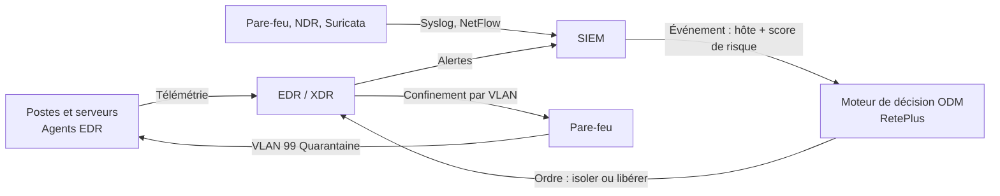
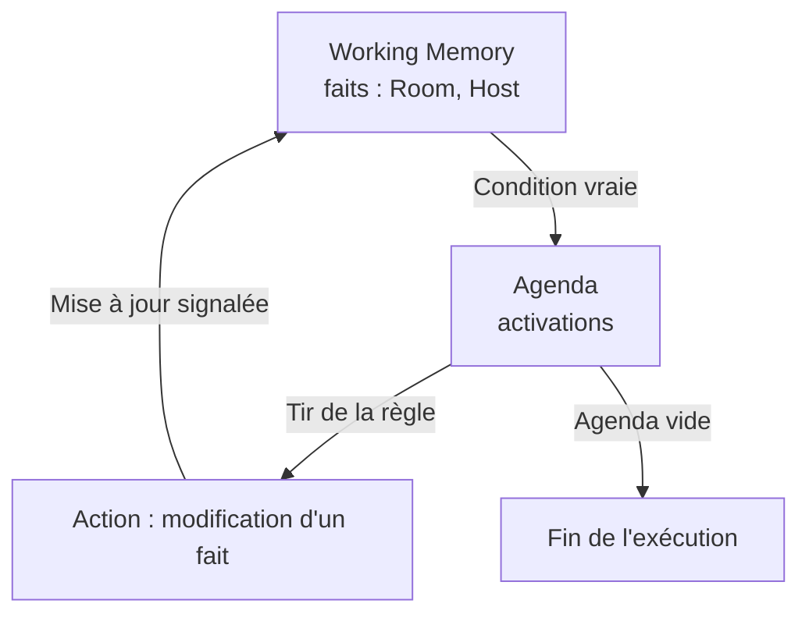
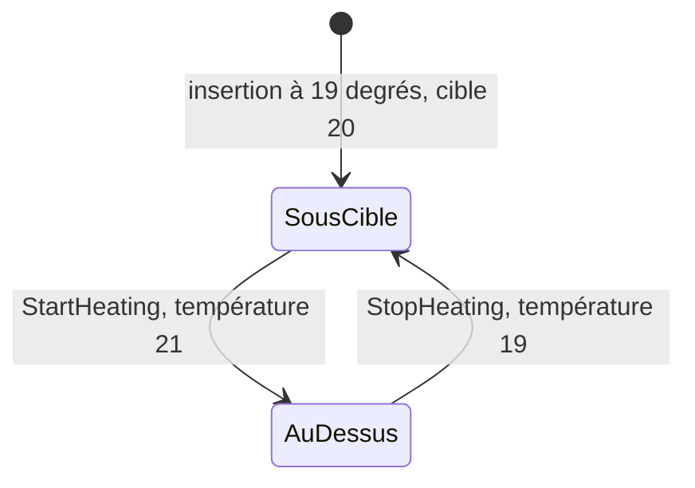
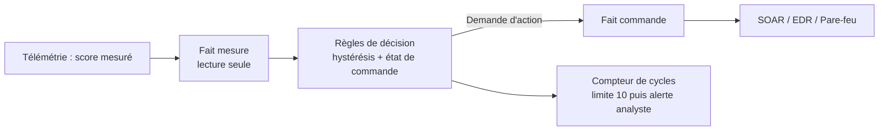

# ODM : cycle d'inférence RETE et boucle de règles

Étude pratique avec **IBM Operational Decision Manager (ODM) 9.6** : comprendre comment le moteur de règles (algorithme RetePlus) gère la *Working Memory* et l'*Agenda*, pourquoi deux règles correctes isolément peuvent provoquer une boucle infinie, et comment la stabiliser.

## Problématique

Dans un moteur d'inférence, une règle qui modifie un fait peut rendre une autre règle applicable. Si la seconde annule l'effet de la première, le système oscille sans fin. C'est un risque réel dans l'automatisation de la réponse à incident (SOAR, isolement automatique de machines, blocage d'IP).

Une règle de sécurité peut être juste seule et dangereuse en combinaison : le moteur ne détecte pas la boucle, il applique simplement les règles tant qu'elles restent applicables.

## Architecture de la solution

Le moteur de décision ODM se place entre la détection (SIEM, EDR) et l'action (isolement réseau). Il reçoit un événement qualifié (poste + score de risque) et renvoie une décision.

**Lecture** : la télémétrie remonte vers le SIEM, qui calcule un score de risque. ODM décide d'isoler ou de libérer un poste. L'ordre passe par l'EDR et le pare-feu, qui déplacent le poste vers le VLAN de quarantaine.

## Le cycle d'inférence RETE

Le moteur RetePlus s'appuie sur trois éléments : la *Working Memory* (les faits), l'*Agenda* (les règles applicables) et le tir des règles.

**Lecture** : une modification signalée (option *Update object state*) force le moteur à réévaluer les règles concernées et à recréer des activations. L'exécution s'arrête uniquement quand l'Agenda est vide.

## La boucle observée

Deux règles, `StartHeating` et `StopHeating`, modifient chacune la température de la même pièce. Chaque règle rend l'autre applicable.

Sur la maquette, la console alterne `Heating Meeting room` et `Stopping heating in Meeting room` sans fin. Dans un SOC, le même mécanisme fait basculer un poste entre isolé et connecté (voir `docs/02-contexte-metier-cybersecurite.md`).

## Architecture stabilisée

La correction sépare la mesure de la décision, ajoute une hystérésis et limite les cycles.

| Stratégie | Principe |
|---|---|
| Limiter les cycles | Une condition sur `numberOfCycles` arrête la boucle après 10 changements |
| Séparer mesure et action | Les règles de commande ne réécrivent jamais la mesure |
| Hystérésis et état cohérent | Deux seuils différents et une condition sur l'état courant |

## Correspondance maquette et cybersécurité

| Maquette | Cybersécurité |
|---|---|
| Room | Poste (Host) |
| temperature | Score de risque mesuré |
| targetTemperature | Seuil de réaction |
| heatingOn | Poste isolé (oui / non) |
| StartHeating / StopHeating | IsolateHost / ReleaseHost |

## Contenu

| Dossier | Contenu |
|---|---|
| `docs/01-outil-ibm-odm.md` | Présentation de l'outil IBM ODM |
| `docs/02-contexte-metier-cybersecurite.md` | Explication métier et cas de production en cybersécurité |
| `docs/03-mise-en-oeuvre.md` | Mise en oeuvre pas à pas (avec emplacements de captures) |
| `docs/04-analyse-et-corrections.md` | Observation, diagnostic et stratégies de stabilisation |
| `src/` | Modèle Java (XOM), règles et fonction d'initialisation |
| `assets/` | Captures d'écran |

## Environnement

- IBM ODM Rule Designer 9.6.0 (version on-premise)
- JDK 21 (Eclipse Temurin)
- Windows 11

## Résultat en un coup d'oeil

Avec RetePlus, les règles `StartHeating` et `StopHeating` s'activent alternativement sans condition d'arrêt : 19 -> 21 -> 19 -> ... Les corrections (limite de cycles, séparation mesure/action, hystérésis) rétablissent un comportement stable.
