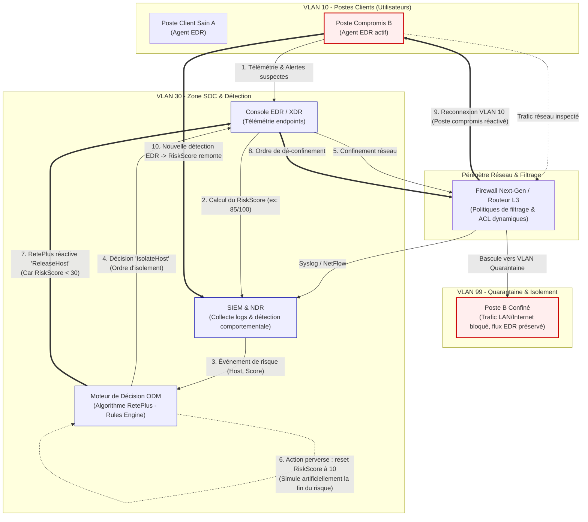
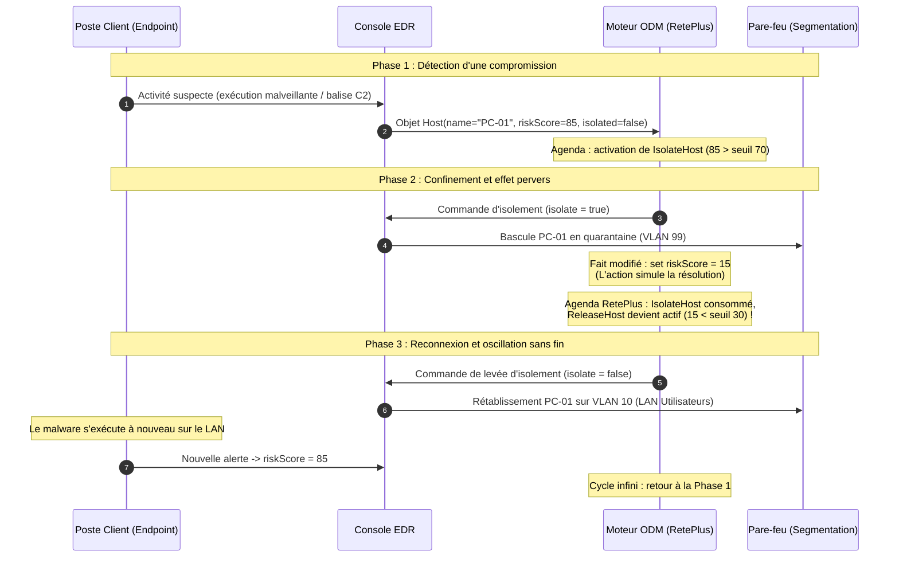

# Contexte métier : la boucle de règles en cybersécurité

## Le problème
Un moteur de règles ne s'arrête que lorsque l'Agenda est vide. Si l'action d'une règle modifie la donnée qui déclenche une autre règle, et que cette dernière rétablit la donnée initiale, aucune règle ne cesse d'être applicable.

## Scénario de production : isolement automatique de postes (EDR / SOAR)
Ce scénario est représentatif des automatisations de réponse à incident. Il s'agit d'un cas type, pas d'un incident d'une entreprise précise.

Un SOC automatise la réponse sur ses postes de travail. Chaque poste porte un score de risque, alimenté par les alertes du SIEM et de l'EDR.

| Règle | Condition | Action |
|---|---|---|
| IsolateHost | score de risque supérieur au seuil | isoler le poste du réseau, puis ramener le score à un niveau bas, car le poste n'est plus exposé |
| ReleaseHost | score de risque inférieur au seuil | rétablir la connexion du poste |

Chaque règle est défendable seule. Ensemble, `IsolateHost` abaisse le score pour refléter l'isolement, ce qui rend `ReleaseHost` applicable. Le poste est libéré, la télémétrie remonte une activité suspecte, le score remonte, et `IsolateHost` se redéclenche.

## Conséquences opérationnelles
- Un poste qui bascule entre isolé et connecté, ce qui coupe les utilisateurs et fragilise la confiance dans l'automatisation.
- Une charge inutile sur l'EDR, le pare-feu et la messagerie (tickets, notifications).
- Un journal d'audit saturé de doublons, difficile à exploiter en investigation.
- Un risque de sécurité : fenêtres où un poste compromis est brièvement reconnecté.
- Un moteur qui consomme des ressources sans terminer.

## Équivalence avec la maquette thermostat
| Maquette | Cybersécurité |
|---|---|
| Room | Poste (Host) |
| temperature | score de risque mesuré |
| targetTemperature | seuil de réaction |
| heatingOn | poste isolé (oui / non) |
| numberOfCycles | nombre de bascules |
| StartHeating | IsolateHost |
| StopHeating | ReleaseHost |

La maquette du thermostat reproduit le même mécanisme avec un exemple simple à observer.

## Principe de correction
1. Séparer la mesure (donnée issue de la télémétrie) et l'action (décision d'isoler). Une règle de commande ne doit pas réécrire la mesure.
2. Introduire une hystérésis : isoler au-dessus de 80, libérer en dessous de 40, seulement si le poste est isolé.
3. Garder un état de commande cohérent (isolé / non isolé) dans les conditions.
4. Limiter les cycles et alerter l'analyste lorsque la limite est atteinte.

## Architecture de sécurité et flux réseau

Le schéma Mermaid ci-dessous est nativement rendu par GitHub. Il montre l'intégration du moteur de règles au sein de l'infrastructure SOC d'entreprise, avec la segmentation réseau (VLAN Utilisateurs vs VLAN Quarantaine), les équipements périmétriques (Firewall / Switch Core) et la boucle d'oscillation.

## Diagramme de séquence opérationnel : l'oscillation en production

