# Mise en oeuvre

Les captures sont à ajouter dans `assets/` avec les noms indiqués.

## 1. Workspace
Rule Designer : File > Switch Workspace > `C:\Users\<user>\workspace-odm\ODM-Thermostat`.

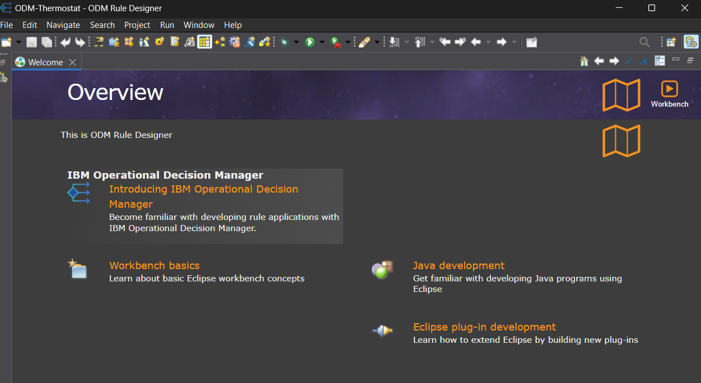

## 2. Projet Java (XOM)
Perspective Java > Package Explorer : projet `ThermostatXOM`, JavaSE-21, sans `module-info.java`.

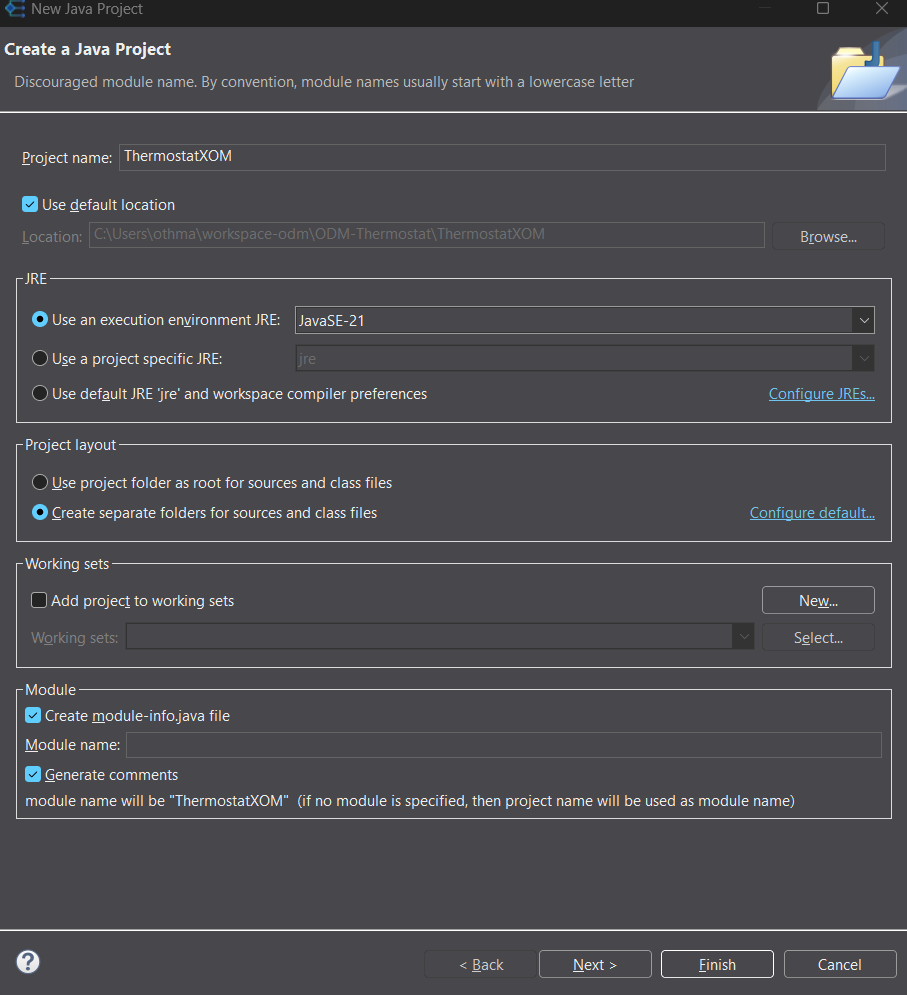

## 3. Classe Room
Package `thermostat`, classe `Room` avec getters et setters (voir `src/ThermostatXOM/thermostat/Room.java`).

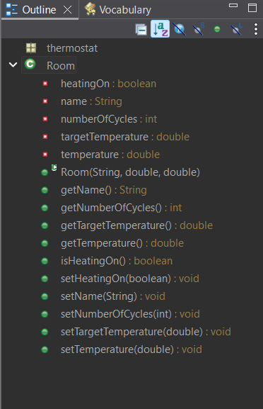

## 4. Rule Project et lien XOM
Perspective Rule > Rule Explorer : projet `ThermostatRules`, puis Properties > Java Execution Object Model > cocher `ThermostatXOM`.

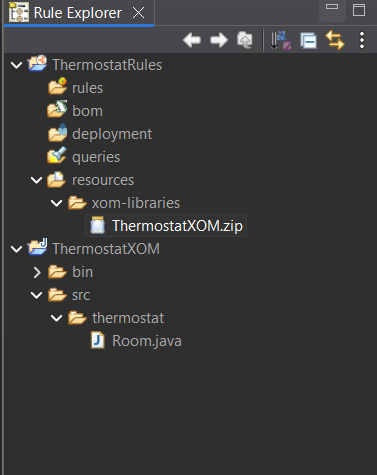
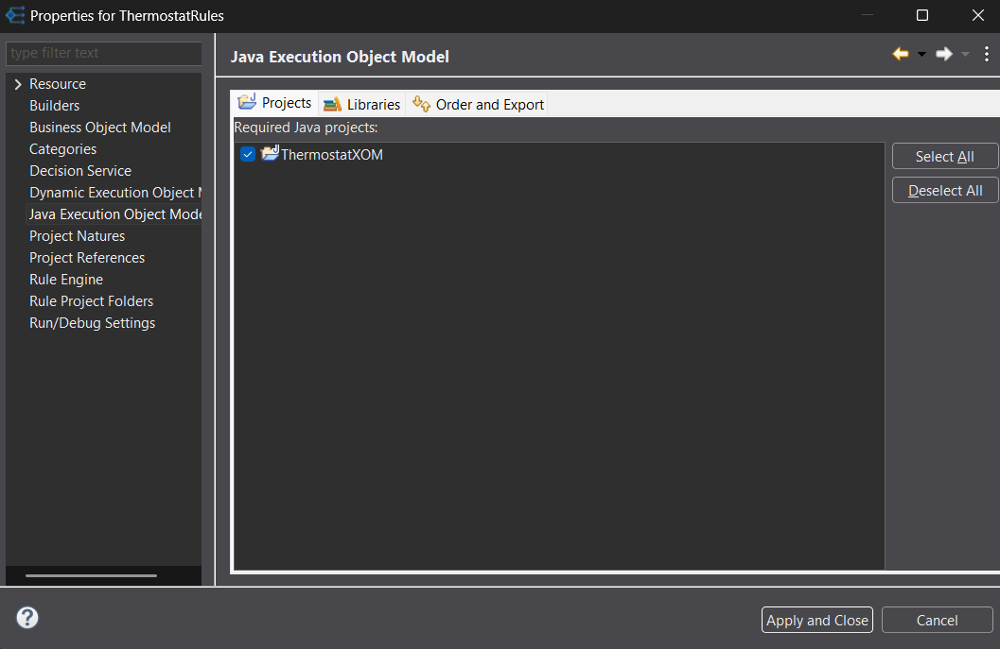

## 5. BOM Entry
Rule Explorer > `bom` > New > BOM Entry > `thermostat.Room`.

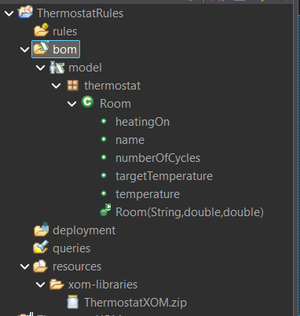

## 6. Vocabulaire
Contrôle de `model.bom` et `model_en_US.voc`.

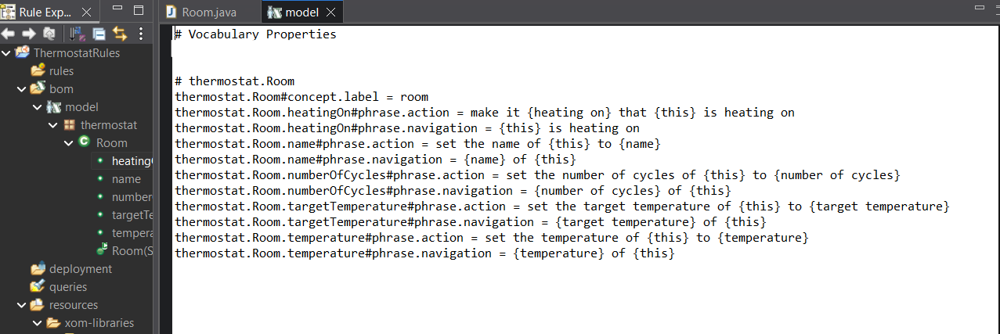

## 7. Update object state
Cocher *Update object state* sur `temperature`, `heatingOn` et `numberOfCycles`. Cette option informe le moteur qu'un attribut modifié doit réévaluer les règles.

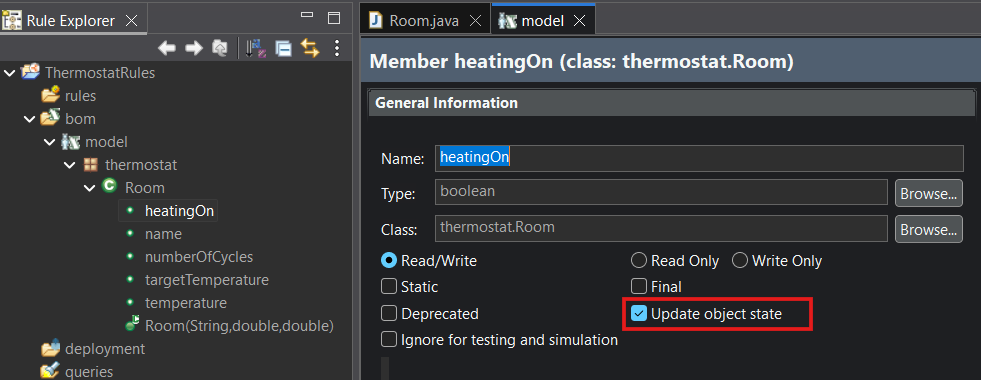

## 8. Règles
Package `thermostat` : `StartHeating` et `StopHeating` (voir `src/rules/`).

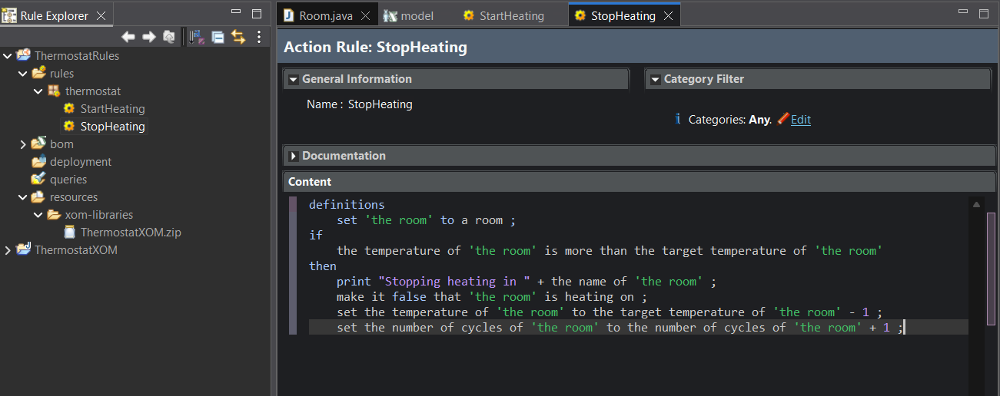

## 9. Ruleflow
Ruleflow `main` : Start > `heatingTask` > End. Algorithme **RetePlus**, package `thermostat` sélectionné.

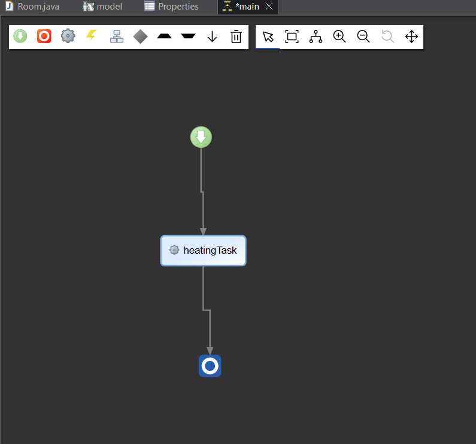

## 10. Fonction d'initialisation
Package `functions`, fonction `InsertObjects`, appelée dans les *initial actions* du nœud Start.

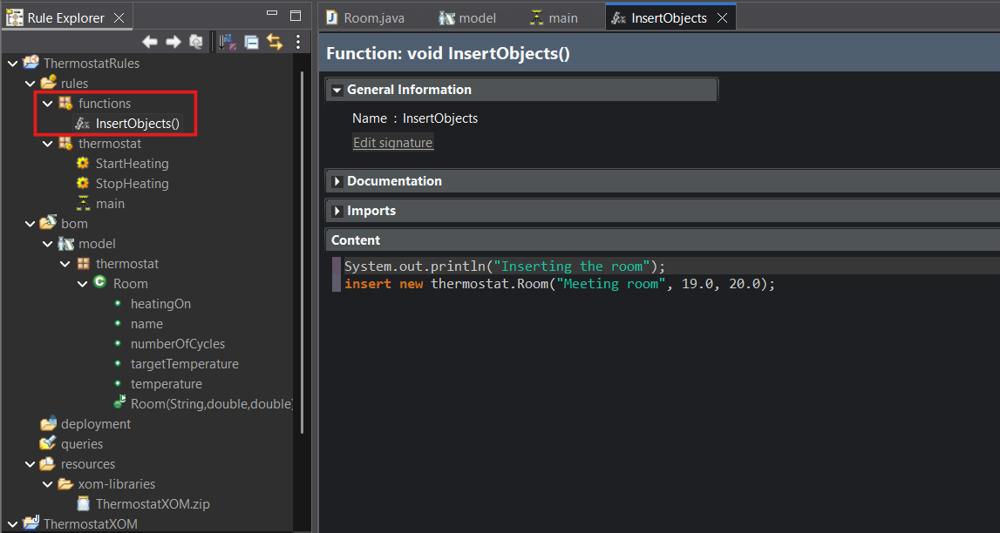

## 11. Exécution
Decision Operation `thermostat` dans `deployment`, puis Run Configuration. La console alterne `Heating Meeting room` et `Stopping heating in Meeting room` sans fin.

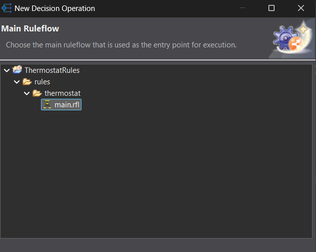
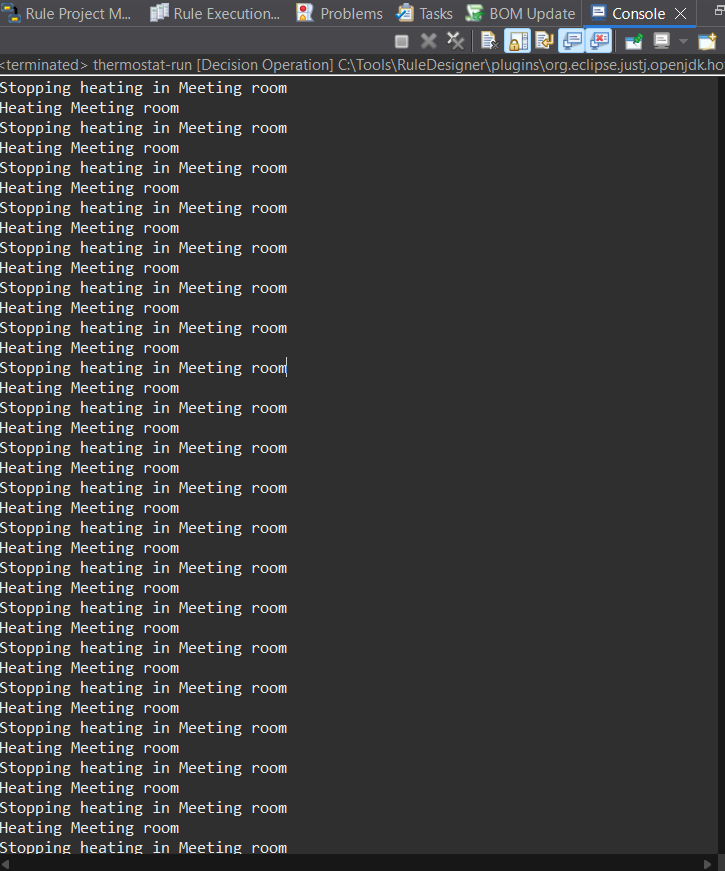
