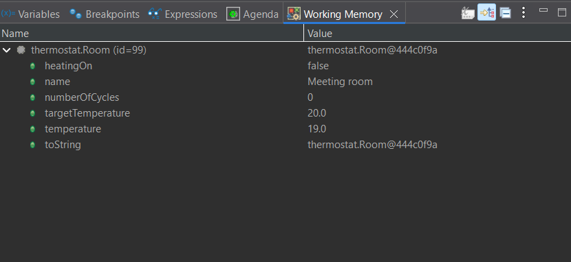
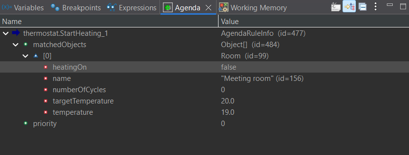

# Analyse et corrections

## Observation en debug
Breakpoint sur chaque règle, lancement en mode Debug.

| Arrêt | Règle | temperature | heatingOn | numberOfCycles | Agenda |
|---|---|---|---|---|---|
| 1 | StartHeating (avant tir) | 19.0 | false | 0 | 1 activation : StartHeating |
| 2 | StopHeating | à compléter | à compléter | à compléter | à compléter |
| 3 | StartHeating | à compléter | à compléter | à compléter | à compléter |

## Diagnostic
- Fait modifié : `temperature` de la même `Room`.
- Après StartHeating, la température passe à cible + 1, donc supérieure à la cible : StopHeating devient applicable.
- Après StopHeating, la température passe à cible - 1 : StartHeating redevient applicable.
- Chaque règle simule l'effet physique de sa propre décision, ce qui déclenche artificiellement la règle opposée.

## Correction A : limiter les cycles
Ajouter à chaque règle la condition `the number of cycles of 'the room' is less than 10`. Le moteur s'arrête quand aucune règle n'est plus applicable.

## Correction B : séparer mesure et action
Les règles de commande ne modifient plus la température. Une règle ou un capteur externe fournit la mesure. Les règles décident seulement l'état du chauffage.

## Correction C : hystérésis et état cohérent
- StartHeating : température inférieure à 19 et chauffage éteint.
- StopHeating : température supérieure à 22 et chauffage allumé.

L'hystérésis seule ne suffit pas si les règles continuent à forcer directement la température. La conception robuste combine hystérésis, état de commande et mesures externes.

## Travaux complémentaires
- Insérer plusieurs pièces et comparer les activations.
- Tester une priorité fondée sur la température ou sur le nombre de cycles.
- Ajouter une règle d'alerte quand `numberOfCycles` atteint 10.
- Comparer les traces avant et après correction.
